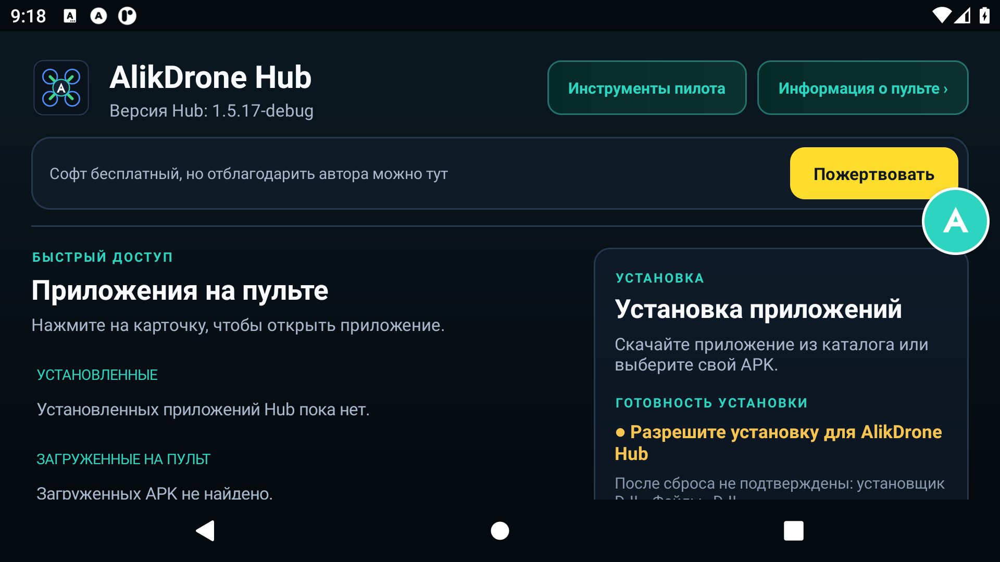
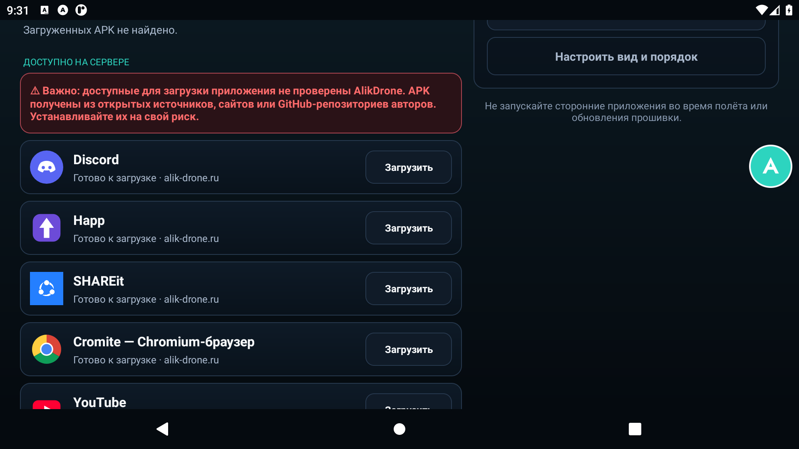
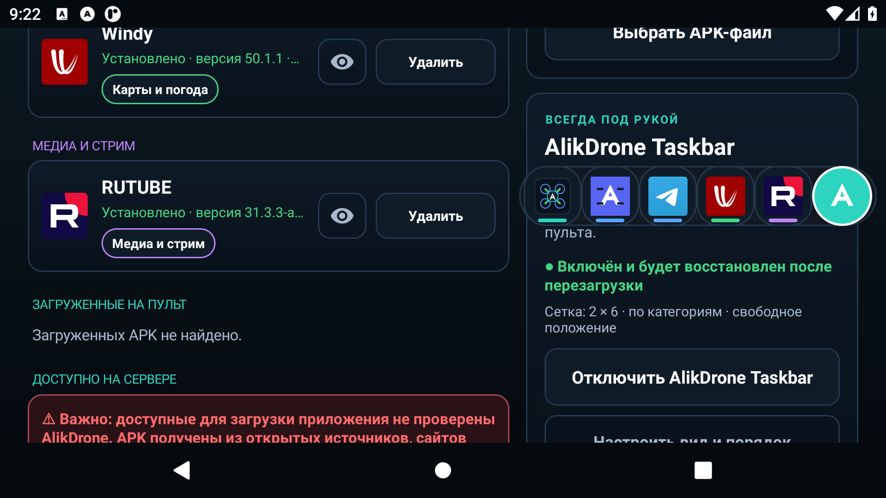
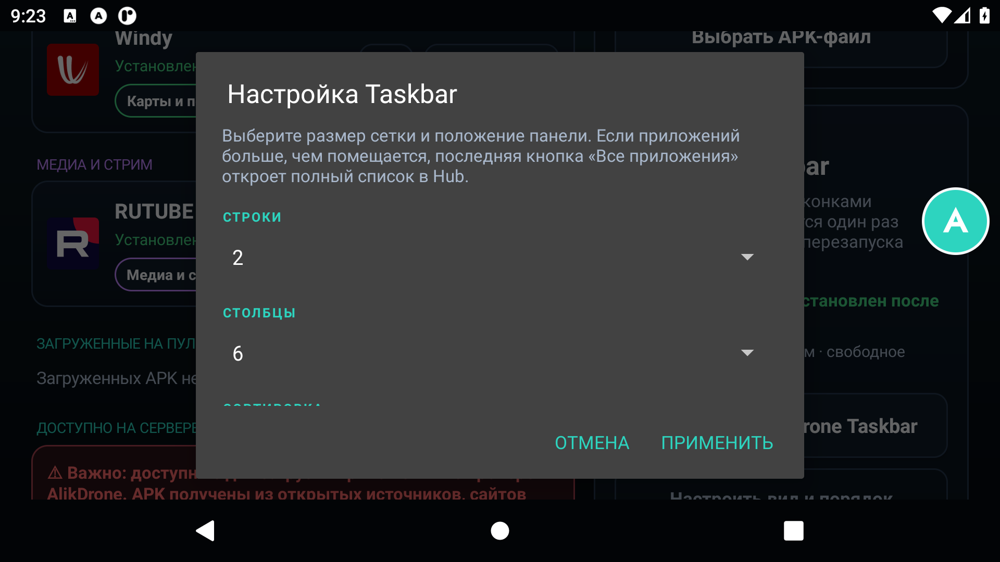
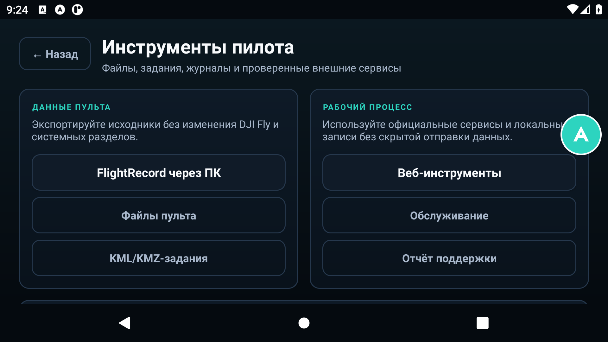
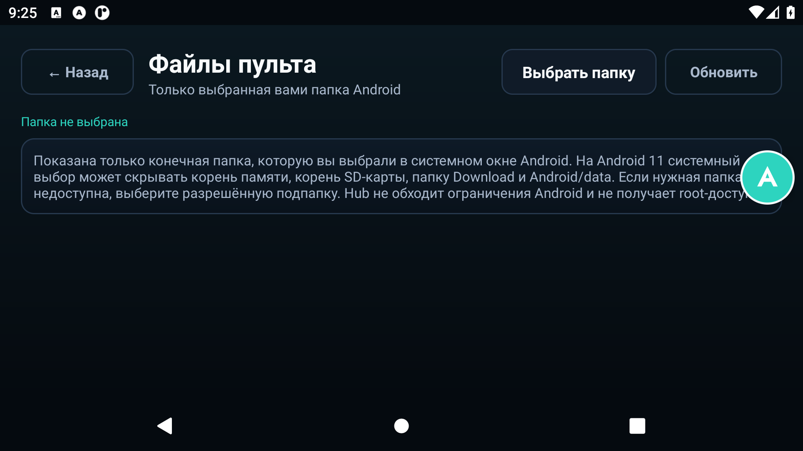
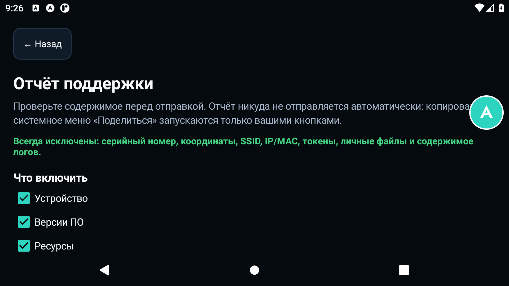

# AlikDrone Hub

[](https://github.com/Dazdra/AlikDrone-Hub/actions/workflows/android.yml)
[](https://github.com/Dazdra/AlikDrone-Hub/releases)
[](LICENSE)

**AlikDrone Hub** — бесплатный центр приложений, Taskbar и инструментов пилота для пультов DJI на Android. Работает без root, не изменяет DJI Fly и передаёт установку штатному Android Package Installer с обязательным подтверждением пользователя.

> **Статус: BETA.** Версия уже протестирована на трёх моделях пультов, но обратная связь и отчёты об ошибках приветствуются.

## Проверенные устройства

- DJI RC 2;
- DJI RC Pro 2;
- DJI RC Plus 2 Enterprise.

Поддержка других Android-пультов DJI возможна, но пока не подтверждена практическими тестами.

## Возможности

- единый список установленных приложений, APK/XAPK на пульте и доступного каталога;
- установка и удаление через штатные системные окна Android;
- плавающий AlikDrone Taskbar: быстрый запуск, категории, порядок, скрытие и сетка иконок;
- информация о пульте, батарее, памяти, Android и экране;
- экспорт FlightRecord, файлы пульта, KML/KMZ-задания и журнал обслуживания;
- Web Tools и безопасно очищаемый отчёт для поддержки;
- работа с APK на microSD без ADB и root.

Публичный каталог содержит: **Telegram, Discord, YouTube, RUTUBE, Cromite, Happ, SHAREit и Windy**. Репозиторий не хранит сторонние APK/XAPK — в исходниках находятся только адрес зеркала, версия и контрольные данные.

## Скачать и установить

1. Откройте [Releases](https://github.com/Dazdra/AlikDrone-Hub/releases) и скачайте APK из последнего BETA-релиза.
2. Скопируйте файл на microSD или во внутреннюю память пульта.
3. Откройте APK на пульте и подтвердите установку в штатном окне Android.
4. Если Android запрещает установку, следуйте [пошаговой инструкции AlikDrone](https://alik-drone.ru/).

Текущий APK подписан тестовым Android-ключом и публикуется как BETA. Перед обновлением сборки с другой подписью Android может потребовать удалить предыдущую версию.

## Галерея

Скриншоты сняты на тестовом окружении; набор установленных приложений и системные данные на реальном пульте будут отличаться.

| Главный экран | Каталог приложений |
|---|---|
|  |  |

| Быстрый Taskbar | Настройка Taskbar |
|---|---|
|  |  |

| Инструменты пилота | Файлы пульта |
|---|---|
|  |  |



## Важные предупреждения

- Доступные для загрузки сторонние приложения **не проверены AlikDrone** и получены из открытых источников, сайтов или репозиториев их авторов. Устанавливайте их на свой риск.
- Telegram и Discord на пульте могут работать нестабильно. Рекомендуется отключить в них уведомления.
- Не запускайте сторонние приложения и Taskbar во время полёта или обновления прошивки.
- Hub не получает root-доступ, не обходит системную защиту и не устанавливает приложения без подтверждения владельца пульта.

## Сборка из исходников

Требуются JDK 17+ и Android SDK Platform 30.

```powershell
Copy-Item local.properties.example local.properties
# Укажите sdk.dir в local.properties
.\gradlew.bat --no-daemon testGithubUnitTest lintGithub assembleGithub
```

Linux/macOS:

```bash
cp local.properties.example local.properties
./gradlew --no-daemon testGithubUnitTest lintGithub assembleGithub
```

Результат: `app/build/outputs/apk/github/app-github.apk`.

Секреты подписи, `local.properties`, keystore и сторонние APK нельзя добавлять в репозиторий. Для собственной подписи используйте `keystore.properties.example`.

## Обратная связь

Мы рады обратной связи. Для ошибки создайте [Bug report](https://github.com/Dazdra/AlikDrone-Hub/issues/new?template=bug_report.yml), а для идеи — [Feature request](https://github.com/Dazdra/AlikDrone-Hub/issues/new?template=feature_request.yml).

Укажите модель пульта, версию Hub, шаги воспроизведения и приложите скриншот. Перед публикацией отчёта обязательно проверьте, что в нём нет личных данных.

## Лицензия

Исходный код AlikDrone Hub распространяется по лицензии [GNU GPL-3.0](LICENSE). Названия и товарные знаки DJI и сторонних приложений принадлежат их владельцам. Сторонние APK/XAPK не входят в состав репозитория и не распространяются по GPL вместе с Hub.

